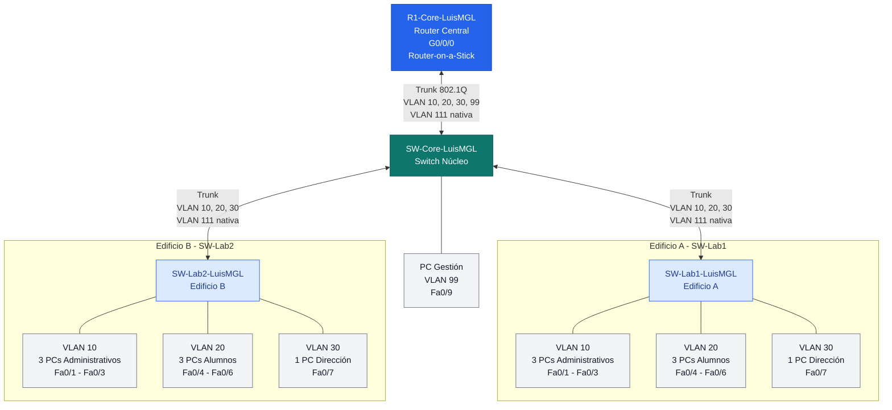

# portafolio_ccna2
# Topología de Red: Router-on-a-Stick con VLANs


## 1. Diagrama de la topología

```bash
                 [ R1-Core-LuisMGL (Router) ]
                          |
                          | G0/0/0
                          | Trunk 802.1Q
                          | Router-on-a-Stick
                          | VLANs 10, 20, 30, 99
                          | VLAN 111 nativa
                          |
                     [ SW-Core-LuisMGL ]
                       /       \
              (Trunk) /         \ (Trunk)
          VLAN 111 nativa     VLAN 111 nativa
                    /             \
             [ SW-Lab1-LuisMGL ]       [ SW-Lab2-LuisMGL ]
             Edificio A        Edificio B

     Dispositivos en SW-Lab1-LuisMGL:       Dispositivos en SW-Lab2-LuisMGL:

     ├── VLAN 10: 3 PCs Admin       ├── VLAN 10: 3 PCs Admin
     │   Fa0/1 - Fa0/3              │   Fa0/1 - Fa0/3
     │                              │
     ├── VLAN 20: 3 PCs Alumnos     ├── VLAN 20: 3 PCs Alumnos
     │   Fa0/4 - Fa0/6              │   Fa0/4 - Fa0/6
     │                              │
     └── VLAN 30: 1 PC Dirección   └── VLAN 30: 1 PC Dirección
         Fa0/7                          Fa0/7


     Conexión local de SW-Core-LuisMGL:

     └── VLAN 99: 1 PC Gestión
         Puerto Fa0/9
```

## 2. Diagrama gráfico con Mermaid



## 3. Tabla de direccionamiento

Todas las subredes indicadas para las VLAN 10, 20, 30 y 99 usan máscara
`/24` (`255.255.255.0`). En cada subred, la primera dirección utilizable
es `.1` y la última es `.254`.

### 3.1 Tabla A. Infraestructura

  ### 3.1 Tabla de Direccionamiento de Segmentos / VLANs

| Segmento | VLAN | Red/CIDR | Máscara | Primera IP utilizable | Última IP utilizable | Gateway |
| :--- | :---: | :---: | :---: | :---: | :---: | :---: |
| Administración | 10 | `192.168.10.0/24` | `255.255.255.0` | `192.168.10.1` | `192.168.10.254` | `192.168.10.254` |
| Laboratorios | 20 | `192.168.20.0/24` | `255.255.255.0` | `192.168.20.1` | `192.168.20.254` | `192.168.20.254` |
| Dirección | 30 | `192.168.30.0/24` | `255.255.255.0` | `192.168.30.1` | `192.168.30.254` | `192.168.30.254` |
| Gestión | 99 | `192.168.99.0/24` | `255.255.255.0` | `192.168.99.1` | `192.168.99.254` | `192.168.99.254` |
| VLAN nativa | 111 | No especificada en el documento | No especificada | No asignada | No asignada | No asignado |
| Blackhole / puertos inactivos | 999 | No se especifica una subred | No especificada | No asignada | No asignada | No asignado |

*Las puertas de enlace de las VLAN 10, 20, 30 y 99 se configuran con la última IP utilizable de cada subred en las subinterfaces del router.*

---

### 3.2 Direcciones SVI de los switches

| Dispositivo | Interfaz VLAN | Dirección IP/CIDR | Gateway predeterminado |
| :--- | :---: | :---: | :---: |
| `SW-Core-LuisMGL` | `Vlan99` | `192.168.99.1/24` | `192.168.99.254` |
| `SW-Lab1-LuisMGL` | `Vlan99` | `192.168.99.2/24` | `192.168.99.254` |
| `SW-Lab2-LuisMGL` | `Vlan99` | `192.168.99.3/24` | `192.168.99.254` |

---

### 3.4 Tabla B. Hosts

*Se asignan direcciones estáticas consecutivas dentro de cada VLAN. La PC de gestión usa `192.168.99.4`, porque las direcciones `.1`, `.2` y `.3` se reservan para las SVI de los tres switches.*

| Dispositivo | VLAN | Dirección IP/CIDR | Máscara | Gateway predeterminado |
| :--- | :---: | :---: | :---: | :---: |
| PC-Admin-Lab1-1 | 10 | `192.168.10.1/24` | `255.255.255.0` | `192.168.10.254` |
| PC-Admin-Lab1-2 | 10 | `192.168.10.2/24` | `255.255.255.0` | `192.168.10.254` |
| PC-Admin-Lab1-3 | 10 | `192.168.10.3/24` | `255.255.255.0` | `192.168.10.254` |
| PC-Admin-Lab2-1 | 10 | `192.168.10.4/24` | `255.255.255.0` | `192.168.10.254` |
| PC-Admin-Lab2-2 | 10 | `192.168.10.5/24` | `255.255.255.0` | `192.168.10.254` |
| PC-Admin-Lab2-3 | 10 | `192.168.10.6/24` | `255.255.255.0` | `192.168.10.254` |
| PC-Alumno-Lab1-1 | 20 | `192.168.20.1/24` | `255.255.255.0` | `192.168.20.254` |
| PC-Alumno-Lab1-2 | 20 | `192.168.20.2/24` | `255.255.255.0` | `192.168.20.254` |
| PC-Alumno-Lab1-3 | 20 | `192.168.20.3/24` | `255.255.255.0` | `192.168.20.254` |
| PC-Alumno-Lab2-1 | 20 | `192.168.20.4/24` | `255.255.255.0` | `192.168.20.254` |
| PC-Alumno-Lab2-2 | 20 | `192.168.20.5/24` | `255.255.255.0` | `192.168.20.254` |
| PC-Alumno-Lab2-3 | 20 | `192.168.20.6/24` | `255.255.255.0` | `192.168.20.254` |
| PC-Direccion-Lab1 | 30 | `192.168.30.1/24` | `255.255.255.0` | `192.168.30.254` |
| PC-Direccion-Lab2 | 30 | `192.168.30.2/24` | `255.255.255.0` | `192.168.30.254` |
| PC-Gestion | 99 | `192.168.99.4/24` | `255.255.255.0` | `192.168.99.254` |
> En cada PC: **Desktop → IP Configuration → Static**. Introduce la
> dirección IP, la máscara y el gateway indicados en la tabla.

------------------------------------------------------------------------

## 4. Asignar nombre a los dispositivos con las iniciales LuisMGL

Ejecuta en cada dispositivo, en modo privilegiado y luego en
configuración global:

### Router --- `R1-Core-LuisMGL`
```bash
Router>enable
Router#configure terminal
Enter configuration commands, one per line.  End with CNTL/Z.
Router(config)#hostname R1-Core-LuisMGL
R1-Core-LuisMGL(config)#
```


### Switch central --- `SW-Core-LuisMGL`
```bash
Switch>enable
Switch#configure terminal
Enter configuration commands, one per line.  End with CNTL/Z.
Switch(config)#hostname SW-Core-LuisMGL
SW-Core-LuisMGL(config)#
```


### Switch de acceso 1 --- `SW-Lab1-LuisMGL`

```bash
Switch>enable
Switch#configure terminal
Enter configuration commands, one per line.  End with CNTL/Z.
Switch(config)#hostname SW-Lab1-LuisMGL
SW-Lab1-LuisMGL(config)#
```


### Switch de acceso 2 --- `SW-Lab2-LuisMGL`
```bash
Switch>enable
Switch#configure terminal
Enter configuration commands, one per line.  End with CNTL/Z.
Switch(config)#hostname SW-Lab2-LuisMGL
SW-Lab2-LuisMGL(config)#
```


## 5. Configuración básica de seguridad en router y switches
Ejecuta en **router y switchS**, después de establecer el
`hostname`:

```bash
enable
config
enable secret MODULO_PREFERIDO_MANEJOTE
service password-encryption
banner motd #ACCESO RESTRINGIDO: solo personal autorizado#
```


Para configurar una contraseña en la consola:

```bash
line console 0
password MODULO_PREFERIDO_MANEJOTE
login
exit
```
Para la línea VTY, destinada al acceso remoto por terminal:
```bash
line vty 0 4
password <CLAVE_VTY>
login
exit
```

Guarda la configuración al terminar el equipo:
```bash
end
copy running-config startup-config
```

Cuando Packet Tracer pregunte por el nombre del archivo de destino,
pulsa **Enter** para aceptar el valor predeterminado.

------------------------------------------------------------------------
## 5.5 Crear las VLAN 10, 20, 30, 99, 111 y 999

Crea las VLAN en **los tres switches** (`SW-Core-LuisMGL`, `SW-Lab1-LuisMGL` y
`SW-Lab2-LuisMGL`).

```bash
configure terminal
vlan 10
 name Administracion
exit
vlan 20
 name Laboratorios
exit
vlan 30
 name Direccion
exit
vlan 99
 name Gestion
exit
vlan 111
 name Nativa
exit
vlan 999
 name Blackhole
exit
end
```


Verifica la creación:

```bash
show vlan brief
```


Comprueba que aparezcan las seis VLAN. La VLAN 999 se usará para los
puertos que no estén en uso; no asignes a ella los puertos conectados a
PCs ni los enlaces troncales.

------------------------------------------------------------------------

## 6. Asignar los puertos a las VLAN

### 6.1 SW-Lab1-LuisMGL

IRAN A:

-   `Fa0/1` a `Fa0/3`: Administración, VLAN 10.
-   `Fa0/4` a `Fa0/6`: Laboratorios/Alumnos, VLAN 20.
-   `Fa0/7`: Dirección, VLAN 30.

```bash
SW-Lab1-LuisMGL#configure terminal
Enter configuration commands, one per line.  End with CNTL/Z.
SW-Lab1-LuisMGL(config)#interface range fastEthernet 0/1-3
SW-Lab1-LuisMGL(config-if-range)# switchport mode access
SW-Lab1-LuisMGL(config-if-range)# switchport access vlan 10
SW-Lab1-LuisMGL(config-if-range)#exit
SW-Lab1-LuisMGL(config)#interface range fastEthernet 0/4-6
SW-Lab1-LuisMGL(config-if-range)# switchport mode access
SW-Lab1-LuisMGL(config-if-range)# switchport access vlan 20
SW-Lab1-LuisMGL(config-if-range)#exit
SW-Lab1-LuisMGL(config)#interface fastEthernet 0/7
SW-Lab1-LuisMGL(config-if)# switchport mode access
SW-Lab1-LuisMGL(config-if)# switchport access vlan 30
SW-Lab1-LuisMGL(config-if)#exit
SW-Lab1-LuisMGL(config)#end
```


### 6.2 SW-Lab2-LuisMGL

```bash
SW-Lab2-LuisMGL#configure terminal
Enter configuration commands, one per line.  End with CNTL/Z.
SW-Lab2-LuisMGL(config)#interface range fastEthernet 0/1-3
SW-Lab2-LuisMGL(config-if-range)# switchport mode access
SW-Lab2-LuisMGL(config-if-range)# switchport access vlan 10
SW-Lab2-LuisMGL(config-if-range)#exit
SW-Lab2-LuisMGL(config)#interface range fastEthernet 0/4-6
SW-Lab2-LuisMGL(config-if-range)# switchport mode access
SW-Lab2-LuisMGL(config-if-range)# switchport access vlan 20
SW-Lab2-LuisMGL(config-if-range)#exit
SW-Lab2-LuisMGL(config)#interface fastEthernet 0/7
SW-Lab2-LuisMGL(config-if)# switchport mode access
SW-Lab2-LuisMGL(config-if)# switchport access vlan 30
SW-Lab2-LuisMGL(config-if)#exit
SW-Lab2-LuisMGL(config)#end
SW-Lab2-LuisMGL#
%SYS-5-CONFIG_I: Configured from console by console
```


### 6.3 SW-Core-LuisMGL: PC de gestión

Coloca la PC de gestión en `Fa0/9`, VLAN 99.

```bash
SW-Core-LuisMGL#configure terminal
Enter configuration commands, one per line.  End with CNTL/Z.
SW-Core-LuisMGL(config)#interface fastEthernet 0/9
SW-Core-LuisMGL(config-if)# switchport mode access
SW-Core-LuisMGL(config-if)# switchport access vlan 99
SW-Core-LuisMGL(config-if)# no shutdown
SW-Core-LuisMGL(config-if)#exit
SW-Core-LuisMGL(config)#end
```


**No asignes otros puertos de acceso del SW-Core a una VLAN de usuario
sin que corresponda a un dispositivo del diagrama.** Los puertos del
núcleo que conectan con el router y con los switches de laboratorio se
configurarán como troncales en el siguiente apartado.

### 6.4 Verificar la pertenencia a VLAN

En cada switch:

```bash
show vlan brief
```


Comprueba que `Fa0/1-Fa0/3`, `Fa0/4-Fa0/6` y `Fa0/7` estén en las VLAN
indicadas en cada switch de laboratorio, y que `SW-Core-luismgl Fa0/9` esté
en VLAN 99.

------------------------------------------------------------------------
## 7. Habilitar los enlaces troncales

La VLAN nativa requerida es la **VLAN 111**. Configura los puertos que
conectan switch con switch y el puerto del SW-Core que conecta al router
como troncales, permitiendo las VLAN 10, 20, 30, 99 y 111.

### 7.1 SW-Core-LuisMGL

```bash
SW-Core-LuisMGL(config)#interface Gig0/1
SW-Core-LuisMGL(config-if)#switchport mode trunk
SW-Core-LuisMGL(config-if)# switchport trunk native vlan 111
SW-Core-LuisMGL(config-if)# switchport trunk allowed vlan 10,20,30,99,111
SW-Core-LuisMGL(config-if)# no shutdown
SW-Core-LuisMGL(config-if)#exit
SW-Core-LuisMGL(config)#interface f0/24
SW-Core-LuisMGL(config-if)# switchport mode trunk

SW-Core-LuisMGL(config-if)# switchport trunk native vlan 111
SW-Core-LuisMGL(config-if)# switchport trunk allowed vlan 10,20,30,99,111
SW-Core-LuisMGL(config-if)# no shutdown
SW-Core-LuisMGL(config-if)#exit
SW-Core-LuisMGL(config)#interface f0/23
SW-Core-LuisMGL(config-if)# switchport mode trunk

SW-Core-LuisMGL(config-if)# switchport trunk native vlan 111
SW-Core-LuisMGL(config-if)# switchport trunk allowed vlan 10,20,30,99,111
SW-Core-LuisMGL(config-if)# no shutdown
SW-Core-LuisMGL(config-if)#exit
SW-Core-LuisMGL(config)#end
%LINEPROTO-5-UPDOWN: Line protocol on Interface FastEthernet0/24, changed state to down

%LINEPROTO-5-UPDOWN: Line protocol on Interface FastEthernet0/24, changed state to up

%LINEPROTO-5-UPDOWN: Line protocol on Interface FastEthernet0/23, changed state to down

%LINEPROTO-5-UPDOWN: Line protocol on Interface FastEthernet0/23, changed state to up

SW-Core-LuisMGL#
%SYS-5-CONFIG_I: Configured from console by console
```


Ejemplo de sustitución: si el cable hacia SW-Lab1 está conectado a
`GigabitEthernet0/1`, escribe `interface gigabitEthernet 0/1` en lugar
de `interface <INTERFAZ_LAB1>`. **No copies literalmente los marcadores
`<...>` en la CLI.**

### 7.2 SW-Lab1-LuisMGL

Por el puerto que conecta al SW-Core.

```bash
SW-Lab1-LuisMGL#configure terminal
Enter configuration commands, one per line.  End with CNTL/Z.
SW-Lab1-LuisMGL(config)#interface fa0/24
SW-Lab1-LuisMGL(config-if)# switchport mode trunk
SW-Lab1-LuisMGL(config-if)# switchport trunk native vlan 111
SW-Lab1-LuisMGL(config-if)# switchport trunk allowed vlan 10,20,30,99,111
SW-Lab1-LuisMGL(config-if)# no shutdown
SW-Lab1-LuisMGL(config-if)#exit
SW-Lab1-LuisMGL(config)#end
SW-Lab1-LuisMGL#
%SYS-5-CONFIG_I: Configured from console by console
```


### 7.3 SW-Lab2-LuisMGL
Por el puerto que conecta al SW-Core.

```bash
SW-Lab2-LuisMGL#configure terminal
Enter configuration commands, one per line.  End with CNTL/Z.
SW-Lab2-LuisMGL(config)#interface fa0/23
SW-Lab2-LuisMGL(config-if)# switchport mode trunk
SW-Lab2-LuisMGL(config-if)# switchport trunk native vlan 111
SW-Lab2-LuisMGL(config-if)# switchport trunk allowed vlan 10,20,30,99,111
SW-Lab2-LuisMGL(config-if)# no shutdown
SW-Lab2-LuisMGL(config-if)#exit
SW-Lab2-LuisMGL(config)#end
SW-Lab2-LuisMGL#
%SYS-5-CONFIG_I: Configured from console by console

```


> Si el modelo de switch seleccionado no admite alguno de los comandos
> `switchport` mostrados, verifica el modelo y las capacidades de la
> interfaz en Packet Tracer. No cambies la topología para ocultar el
> error.

### 7.4 Verificar los troncales
En cada switch:

```bash
show interfaces trunk
show interfaces <PUERTO_TRONCAL> switchport
```


Comprueba que los enlaces aparezcan como troncales, que la VLAN nativa
sea 111 y que la lista permitida incluya `10,20,30,99,111`.

------------------------------------------------------------------------
## 8. Configurar las SVI de administración y el gateway de los switches

La VLAN 99 se usa para administrar los switches. Configura las
siguientes direcciones.

### 8.1 SW-Core-LuisMGL --- primera IP utilizable

```bash
SW-Core-LuisMGL#configure terminal
Enter configuration commands, one per line.  End with CNTL/Z.
SW-Core-LuisMGL(config)#interface vlan 99
SW-Core-LuisMGL(config-if)# ip address 192.168.99.1 255.255.255.0
SW-Core-LuisMGL(config-if)# no shutdown
SW-Core-LuisMGL(config-if)#exit
SW-Core-LuisMGL(config)#ip default-gateway 192.168.99.254
SW-Core-LuisMGL(config)#end
```


### 8.2 SW-Lab1-LuisMGL --- segunda IP utilizable

```bash
SW-Lab1-LuisMGL#configure terminal
Enter configuration commands, one per line.  End with CNTL/Z.
SW-Lab1-LuisMGL(config)#interface vlan 99
SW-Lab1-LuisMGL(config-if)# ip address 192.168.99.2 255.255.255.0
SW-Lab1-LuisMGL(config-if)# no shutdown
SW-Lab1-LuisMGL(config-if)#exit
SW-Lab1-LuisMGL(config)#ip default-gateway 192.168.99.254
SW-Lab1-LuisMGL(config)#end
```


### 8.3 SW-Lab2-LuisMGL --- tercera IP utilizable

```bash
SW-Lab2-LuisMGL#configure terminal
Enter configuration commands, one per line.  End with CNTL/Z.
SW-Lab2-LuisMGL(config)#interface vlan 99
SW-Lab2-LuisMGL(config-if)# ip address 192.168.99.3 255.255.255.0
SW-Lab2-LuisMGL(config-if)# no shutdown
SW-Lab2-LuisMGL(config-if)#exit
SW-Lab2-LuisMGL(config)#ip default-gateway 192.168.99.254
SW-Lab2-LuisMGL(config)#end
%LINK-5-CHANGED: Interface Vlan99, changed state to up
```


## 8.4 Verifica en cada switch:

```bash
show ip interface brief
show running-config
```
### SW-Core-LuisMGL


### SW-LAB1-LuisMGL


### SW-LAB2-LuisMGL


INVESTIGAR SHOW RUNNING-CONFIG

La SVI puede permanecer `down` hasta que la VLAN exista y haya al menos
un puerto activo que transporte esa VLAN. Comprueba también los enlaces
y la VLAN 99 antes de diagnosticar una dirección IP.

------------------------------------------------------------------------
## 9. Configurar los puertos inactivos en VLAN 999 y apagarlos
Usar VLAN 999 para puertos inactivos y apagarlos.
Aplica este procedimiento en cada switch **solo a los puertos que
confirmes que no están conectados a equipos ni se usan como enlaces**.
No incluyas puertos de PCs, el puerto `Fa0/9` del PC de gestión ni los
enlaces troncales.

### 9.1 SW-Core-LuisMGL
```bash
configure terminal
interface range range fa0/1 - fa0/8,fa0/10-fa0/22,gi0/2
 switchport mode access
 switchport access vlan 999
 shutdown
exit
end
```
```bash
configure terminal
interface range range fa0/8 - fa0/23,gi0/2
 switchport mode access
 switchport access vlan 999
 shutdown
exit
end
```
### 9.2 SW-Lab2-LuisMGL
```bash
configure terminal
interface range range fa0/8 - fa0/22,fa0/24,gi0/2
 switchport mode access
 switchport access vlan 999
 shutdown
exit
end
```
Verifica:

```bash
show vlan brief
show interfaces status
```
------------------------------------------------------------------------
